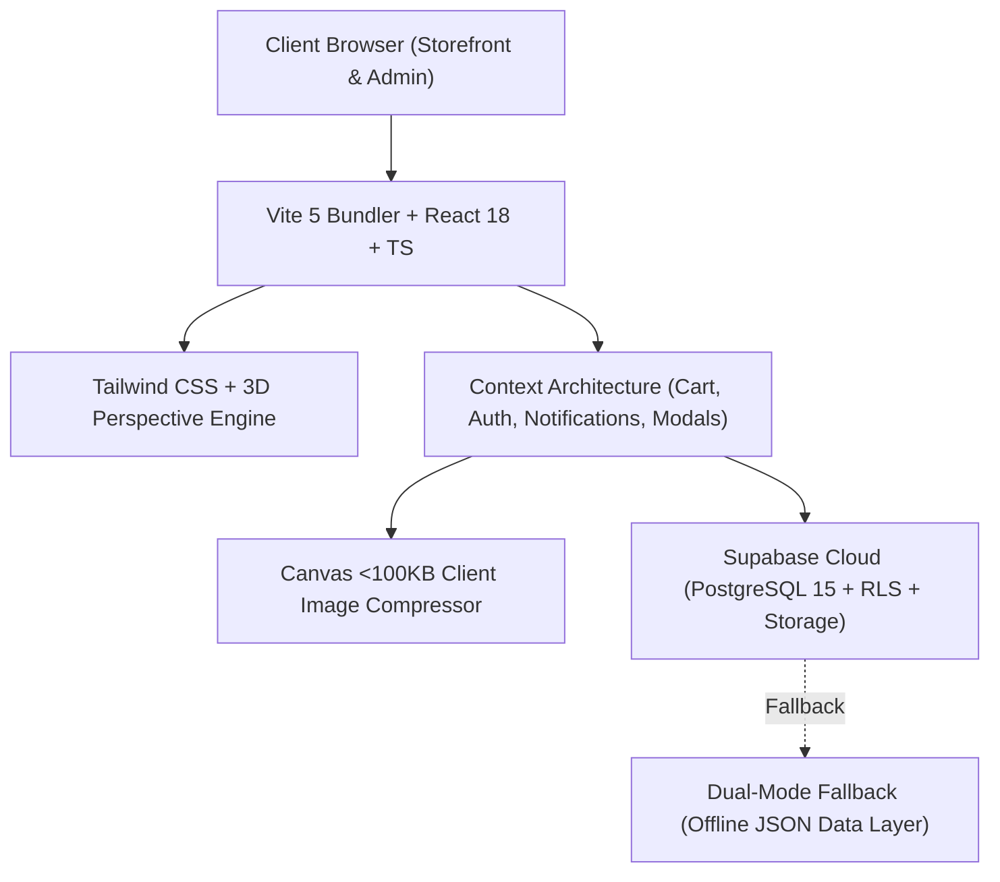

# 🌾 MR. VIVASAYI (மிஸ்டர் விவசாயி)
### Pure, Traditional & Organic Natural Foods Platform — Storefront, POS & Enterprise CRM

[](https://reactjs.org/)
[](https://www.typescriptlang.org/)
[](https://vitejs.dev/)
[](https://tailwindcss.com/)
[](https://supabase.com/)
[]()

---

## 📖 Project Overview

**MR. VIVASAYI** is an end-to-end commerce and retail management platform dedicated to South Indian traditional, heirloom, and organic natural foods. Built to bridge the gap between traditional Tamil Nadu farming families and urban households, MR. VIVASAYI delivers authentic native rice varieties (*Mappillai Samba, Karunguruvai, Poongar, Kullakar, Seeraga Samba*), wood cold-pressed oils (*Marachekku Nallennai, Kadalai Ennai, Thengai Ennai*), unpolished native millets, and chemical-free pulses.

The platform unites two distinct systems into a single, cohesive architecture:
1. **Interactive Public Storefront**: High-performance consumer shopping experience with proprietary 3D Coverflow Carousels, instant WhatsApp ordering, customer review submissions with photo proof, and zero-latency catalog browsing.
2. **Enterprise Operations & CRM Suite**: Full-featured admin back-office for Retail Point of Sale (POS), Multi-tier Pricing & Inventory Management, Live Storefront CMS, Customer Relationship Management, WhatsApp Notification Hub, and Audit Trail Security.

---

## 🛠️ Architecture & Tech Stack



- **Frontend Core**: React 18, TypeScript (Strict Type Checking), Vite 5, React Router DOM v6
- **Styling & 3D Physics**: Tailwind CSS, CSS 3D Perspective Engine (`perspective-1500`, `preserve-3d`, `rotateY`, `translateZ`)
- **Backend & Database**: Supabase PostgreSQL with Row Level Security (RLS), Realtime replication, and dual-mode JSON persistence fallback
- **State Architecture**: React Context API (`CartContext`, `AuthContext`, `NotificationContext`, `ActionModalContext`)
- **Media Optimization**: HTML5 Canvas client-side adaptive JPEG compression (&le; 100 KB threshold)
- **Icons & Visualization**: Lucide React, Recharts (Sales & Financial Reporting)

---

## 🚀 Quick Start & Installation Guide

### Prerequisites
- **Node.js**: v18.0.0 or higher (v20+ recommended)
- **npm**: v9.0.0 or higher
- A modern web browser with CSS 3D transforms enabled

### 1. Clone the Repository
```bash
git clone https://github.com/mrvivasayi/mr-vivasayi.git
cd mr-vivasayi
```

### 2. Install Dependencies
```bash
npm install
```

### 3. Configure Environment Variables
Copy the provided `.env.example` to `.env`:
```bash
cp .env.example .env
```

Ensure your `.env` contains the required Supabase and application parameters:
```env
# Database Mode: true = Real Supabase Cloud, false = Local JSON Store Fallback
VITE_DATABASE_MODULE=true

# Public Client Credentials (Safe for client browser bundling)
VITE_SUPABASE_URL=https://your-project.supabase.co
VITE_SUPABASE_ANON_KEY=your-supabase-publishable-key
VITE_SUPABASE_JWKS_URL=https://your-project.supabase.co/auth/v1/.well-known/jwks.json

# Server-Side / CLI Only (Excluded from client bundle)
SUPABASE_URL=https://your-project.supabase.co
SUPABASE_PUBLISHABLE_KEY=your-supabase-publishable-key
SUPABASE_SECRET_KEY=your-supabase-service-role-key

# Application Settings
VITE_APP_NAME=MR. VIVASAYI
VITE_APP_VERSION=1.0.0
VITE_APP_URL=http://localhost:5173
```

### 4. Run Development Server
```bash
npm run dev
```
Open [http://localhost:5173](http://localhost:5173) in your browser to view the storefront.

### 5. Build for Production
```bash
npm run build
```
This generates an optimized production bundle in the `dist/` folder with type checks (`tsc -b && vite build`).

### 6. Preview Production Build
```bash
npm run preview
```

---

## 📱 Articulated Page & Module Architecture

### 1. Public Storefront Pages

| Route | Page Component | Key Features & Implementation |
| :--- | :--- | :--- |
| `/` | [`HomePage.tsx`](file:///home/ai/Desktop/Project/MR_VIVASAYI/src/pages/public/HomePage.tsx) | • **Dynamic Hero Banner**: Farmer promise badges, WhatsApp order CTA, responsive 3D desktop showcase.<br>• **3D Value Props**: Responsive 2x2 mobile / 4-column desktop cards for Native Seeds, Farmer Direct, Quick Dispatch, Small Batches.<br>• **Category Showcase**: Dynamic filtering displaying only categories that are active and have in-stock products.<br>• **Bestseller Harvests 3D Carousel**: Coverflow physics with auto-advance, touch drag, and quick-add to cart.<br>• **Philosophy & Promise Story**: Sourcing ethics and regional farmer metrics.<br>• **Testimonials & Ratings 3D Carousel**: Exclusive 3D coverflow carousel with verified buyer badges, 5-star ratings, photo attachments, and zoom lightbox. |
| `/products` | [`ProductsPage.tsx`](file:///home/ai/Desktop/Project/MR_VIVASAYI/src/pages/public/ProductsPage.tsx) | • **Multi-Faceted Produce Catalog**: Real-time search by Tamil/English names and SKUs.<br>• **Category Pills**: Dynamically rendered with product counters; filters out empty categories.<br>• **Sort & Filter Suite**: Sort by Price (Low/High), Popularity, Featured; organic-only filter.<br>• **1-Click Reset**: Resets all active filters with toast feedback.<br>• **Quick View Modal**: Inspect pack sizes, savings, and descriptions without leaving catalog. |
| `/products/:id` | [`ProductDetailPage.tsx`](file:///home/ai/Desktop/Project/MR_VIVASAYI/src/pages/public/ProductDetailPage.tsx) | • **Media Gallery**: High-res multi-angle photo strip with active zoom preview.<br>• **Price & Savings Card**: MRP, Offer Price, Gross Savings percentage, and tax breakdown.<br>• **Traditional Heritage Story**: Agricultural origin, heirloom variety details, culinary tips.<br>• **Health & Vitality Badges**: Low GI, high fiber, wood cold-pressed markers.<br>• **Customer Reviews Section**: Embedded reviews specific to the product with photo evidence. |
| `/reviews` | [`ReviewsPublicPage.tsx`](file:///home/ai/Desktop/Project/MR_VIVASAYI/src/pages/public/ReviewsPublicPage.tsx) | • **Community Feedback Wall**: Paginated customer reviews with verified purchase tags.<br>• **Star Breakdown Bar**: Real-time aggregate score, rating distribution bars.<br>• **Filter by Stars**: 1-click filter for 5★, 4★, 3★ reviews + **Reset Filters** button.<br>• **Interactive Review Submission**: Dynamic title suggestions based on product; client-side image compression (&le; 100 KB); instant approval workflow. |
| `/about` | [`AboutPage.tsx`](file:///home/ai/Desktop/Project/MR_VIVASAYI/src/pages/public/AboutPage.tsx) | Sourcing heritage, farmer partnerships across Madurai, Thanjavur, and Erode, organic standards. |
| `/contact` | [`ContactPage.tsx`](file:///home/ai/Desktop/Project/MR_VIVASAYI/src/pages/public/ContactPage.tsx) | Store physical location, interactive Google Map link, WhatsApp direct hotline, email inquiry form. |
| `/terms` | [`TermsConditionsPage.tsx`](file:///home/ai/Desktop/Project/MR_VIVASAYI/src/pages/public/TermsConditionsPage.tsx) | Store policies, terms of trade, shipping & delivery timelines, return conditions. |
| `/privacy` | [`PrivacyPolicyPage.tsx`](file:///home/ai/Desktop/Project/MR_VIVASAYI/src/pages/public/PrivacyPolicyPage.tsx) | User privacy safeguards, WhatsApp messaging consent, data security protocols. |

---

### 2. Administrative & Enterprise Management Suite (`/admin`)

| Admin Module | Route & Component | Functional Scope |
| :--- | :--- | :--- |
| **Staff Authentication** | `/admin/login`<br>[`AdminLoginPage.tsx`](file:///home/ai/Desktop/Project/MR_VIVASAYI/src/pages/admin/AdminLoginPage.tsx) | Role-Based Access Control (RBAC) supporting Super Admin, Owner, Admin, Billing Manager, and Staff roles. |
| **Executive Dashboard** | `/admin`<br>[`DashboardPage.tsx`](file:///home/ai/Desktop/Project/MR_VIVASAYI/src/pages/admin/DashboardPage.tsx) | Live storefront revenue, daily POS sales, low stock alerts, order status counts, and top-selling produce. |
| **Catalog & Pricing** | `/admin/products`<br>[`ProductsManagerPage.tsx`](file:///home/ai/Desktop/Project/MR_VIVASAYI/src/pages/admin/ProductsManagerPage.tsx)<br>[`ProductEditorPage.tsx`](file:///home/ai/Desktop/Project/MR_VIVASAYI/src/pages/admin/ProductEditorPage.tsx) | • Full-page dedicated product creation and editor.<br>• Live Gross Margin % and Buyer Savings % calculator.<br>• Quick Markup shortcuts (+20%, +30%, +50%, 10% OFF MRP).<br>• Real-time Storefront Simulator Preview (Card vs Detail Page view).<br>• Photo carousel manager with client-side &le;100KB image compressor. |
| **Point of Sale (POS)** | `/admin/pos`<br>[`POSPage.tsx`](file:///home/ai/Desktop/Project/MR_VIVASAYI/src/pages/admin/POSPage.tsx)<br>[`POSBillingDetailsPage.tsx`](file:///home/ai/Desktop/Project/MR_VIVASAYI/src/pages/admin/POSBillingDetailsPage.tsx) | High-speed billing terminal with SKU barcode scanning, quick quantity toggles, custom GST breakdown, UPI QR code generation, WhatsApp invoice dispatch, and thermal printing. |
| **Inventory & Movements** | `/admin/inventory`<br>[`InventoryPage.tsx`](file:///home/ai/Desktop/Project/MR_VIVASAYI/src/pages/admin/InventoryPage.tsx) | Stock movement ledger (Purchase, Sale, Damage, Adjustment, Expiry), supplier batch assignments, reorder alerts. |
| **Orders Dispatch** | `/admin/orders`<br>[`OrdersPage.tsx`](file:///home/ai/Desktop/Project/MR_VIVASAYI/src/pages/admin/OrdersPage.tsx) | Comprehensive fulfillment pipeline (`NEW` &rarr; `CONFIRMED` &rarr; `PACKING` &rarr; `READY` &rarr; `OUT_FOR_DELIVERY` &rarr; `DELIVERED`). Syncs directly with customer WhatsApp. |
| **Customer Reviews CRM** | `/admin/reviews`<br>[`ReviewsPage.tsx`](file:///home/ai/Desktop/Project/MR_VIVASAYI/src/pages/admin/ReviewsPage.tsx) | Instant approval engine, Alive/Unlive toggle, single & bulk moderation, admin quick replies, and **3D confirmation pop-up modals** for all destructive or bulk operations. |
| **Customer Relations** | `/admin/customers`<br>[`CustomersPage.tsx`](file:///home/ai/Desktop/Project/MR_VIVASAYI/src/pages/admin/CustomersPage.tsx) | Customer profiles, lifetime purchase totals, channel preferences, order recurrence, and WhatsApp engagement status. |
| **WhatsApp Hub** | `/admin/whatsapp`<br>[`WhatsAppHubPage.tsx`](file:///home/ai/Desktop/Project/MR_VIVASAYI/src/pages/admin/WhatsAppHubPage.tsx) | Transactional messaging templates, dispatch logs, direct chat links, and automated order updates. |
| **Storefront CMS** | `/admin/cms`<br>[`CMSPage.tsx`](file:///home/ai/Desktop/Project/MR_VIVASAYI/src/pages/admin/CMSPage.tsx) | Visual site customizer for Hero Banners, Announcement Ticker Bars, Pop Notifications, Header/Footer navigation, and real-time simulator. |
| **Analytics & Reports** | `/admin/reports`<br>[`ReportsPage.tsx`](file:///home/ai/Desktop/Project/MR_VIVASAYI/src/pages/admin/ReportsPage.tsx) | Graphical revenue analytics, gross margin breakdown, category share pie charts, and Excel/CSV data exports. |
| **Audit Logs** | `/admin/audit`<br>[`AuditLogsPage.tsx`](file:///home/ai/Desktop/Project/MR_VIVASAYI/src/pages/admin/AuditLogsPage.tsx) | Immutable security audit trail recording all catalog updates, sales operations, user auth events, and system mutations. |
| **Settings & Diagnostics** | `/admin/settings`<br>[`SettingsPage.tsx`](file:///home/ai/Desktop/Project/MR_VIVASAYI/src/pages/admin/SettingsPage.tsx) | Delivery charge calculation rules, UPI merchant configuration, Supabase query latency metrics, and database dump/backup. |

---

## 💡 Key Technical Innovations

### 1. Proprietary 3D Coverflow Engine
Unlike standard flat sliders, MR. VIVASAYI implements a GPU-accelerated 3D perspective coverflow:
- **Math**: Cards are placed in a `perspective-1500` stage with dynamic `rotateY`, `translateZ`, and `translateX` transforms derived from their relative offset distance to the active item.
- **Adaptive Responsiveness**: Screen-aware spacing adapts automatically between mobile (`<640px`), tablet (`640px–1024px`), and desktop (`>1024px`) to guarantee zero overflow and effortless finger-swiping.
- **Integrated Lightbox**: Customer photos attached to reviews can be expanded into an interactive high-resolution lightbox modal with one click.

### 2. Client-Side Image Compression (&le; 100 KB)
To preserve database bandwidth and guarantee lightning-fast load times:
- Uploaded review and product images are intercepted before dispatch.
- An HTML5 Canvas pipeline (`compressImageToMax100KB` in [`src/lib/utils.ts`](file:///home/ai/Desktop/Project/MR_VIVASAYI/src/lib/utils.ts)) dynamically scales dimensions and compresses quality until the file size is strictly under 100 KB.

### 3. Pop-Up Action Confirmation Modals
All critical and bulk actions across the CRM (deleting reviews, bulk publishing, hiding items, replying) require interactive confirmation via animated Yes/No modal pop-ups, preventing accidental data loss.

### 4. Zero-Secret Isolation & Security Hardening
- Client build bundles are completely free of private API keys.
- `SUPABASE_SECRET_KEY` is strictly confined to server-side tasks and omitted from client-side `import.meta.env`.
- Database access from browser clients uses Row-Level Security (RLS) policies with the anonymous publishable key.

---

## 📁 Project Directory Structure

```
MR_VIVASAYI/
├── public/                     # Static public assets, favicon, mock fallbacks
├── src/
│   ├── components/
│   │   ├── common/             # Header, Footer, QuickView, Skeletons, Modals
│   │   ├── public/             # 3D Carousels, Product Cards, Simulator
│   │   └── admin/              # POS components, Barcode scanner, KPI widgets
│   ├── contexts/               # Cart, Auth, ActionModal, Notifications
│   ├── lib/
│   │   ├── dbManager.ts        # Supabase CRUD + offline JSON store bridge
│   │   ├── supabase.ts         # Supabase client initialization
│   │   ├── utils.ts            # Formatting, <100KB compressor, calculations
│   │   └── initialData.ts      # Seed data fallback
│   ├── pages/
│   │   ├── admin/              # Admin pages (POS, Catalog, Reviews, CMS, etc.)
│   │   └── public/             # Storefront pages (Home, Products, Reviews, etc.)
│   ├── types/                  # Central TypeScript type definitions
│   ├── App.tsx                 # Route declarations & layout shells
│   ├── main.tsx                # React root mount
│   └── index.css               # Design system tokens, 3D perspective utilities
├── .env.example                # Safe environment variable template
├── package.json                # Project dependencies and npm scripts
├── tsconfig.json               # TypeScript compiler options
└── vite.config.ts              # Vite bundler build settings
```

---

## 📜 Available NPM Scripts

- `npm run dev`: Launches the local development server with Vite Hot Module Replacement (HMR).
- `npm run build`: Runs TypeScript compiler (`tsc -b`) and generates production bundles in `dist/`.
- `npm run preview`: Locally serves the production build from `dist/` to verify performance.
- `npm run lint`: Analyzes codebase with ESLint to ensure code quality standards.

---

## 🌾 Mission & Farmer Empowerment

Every transaction on MR. VIVASAYI directly supports regional agricultural heritage in Tamil Nadu. By guaranteeing fair producer prices and cutting out exploitative middlemen, we help farming families continue cultivating traditional heirloom seeds for generations to come.

**MR. VIVASAYI — Pure. Traditional. Straight from the Farm.**
